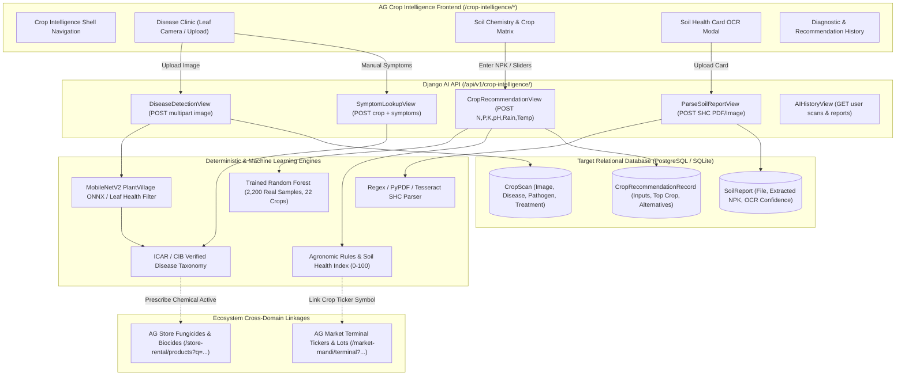

# AgriMart Crop Intelligence: Disease Clinic & Soil Crop Recommendation Analysis and Implementation Plan

**Engagement Principal:** Maik  
**Lead Systems Engineer:** Byte  
**Date:** 2026-11-05  
**Codebases Analyzed:**
- **Source Platform:** `C:\Users\User\Desktop\VIBEATHON 2026\AgriMart-Market-Intelligence\`
- **Target Platform:** `C:\Users\User\Desktop\MINI PROJECT\`

---

## 1. Executive Orientation & Context Clarification

In the preceding engagement turn, the operational brief was:
> *"TASK: INTEGRATE THE EXISTING VIBEATHON AI COPILOT INTO THE MINOR PROJECT'S AG MARKET APPLICATION... PROJECT A — Minor Project (TARGET) Location: `C:\Users\User\Desktop\MINI PROJECT\` ... PROJECT B — VIBEATHON 2026 (SOURCE) Location: `C:\Users\User\Desktop\VIBEATHON 2026\AgriMart-Market-Intelligence\`"*

That integration strictly scoped the **Market Intelligence Copilot** as a submodule inside **AG Market** (`/market-mandi/*`), keeping the source repository read-only, connecting the copilot to the target's live APMC database, and leaving AG Store and AG Crop completely isolated.

Now, you have requested a full architectural analysis of the **Disease Clinic** and **Soil Crop Recommendation** modules across both codebases, followed by a concrete engineering implementation and improvement plan.

This report conducts the audit, highlights where mock/synthetic implementations exist vs. real data modeling, and establishes the blueprint for building and elevating these capabilities into production-grade systems.

---

## 2. Current State Audit: What Exists Today

### 2.1 The VIBEATHON 2026 Implementation

In `VIBEATHON 2026\AgriMart-Market-Intelligence\`, the disease clinic and crop recommendation features were built as **client-side demonstrator views**:

```text
VIBEATHON 2026/
├── frontend/src/
│   ├── pages/
│   │   ├── DiseaseDetectionPage.jsx       <-- Rich standalone leaf diagnostic UI
│   │   └── CropRecommendationPage.jsx     <-- Rich soil matrix & NPK calculation UI
│   ├── data/
│   │   ├── diseaseData.js                 <-- 5 certified pathology profiles
│   │   └── cropRecommendationData.js      <-- 4 soil presets + 3-tier heuristic rule calculator
│   └── assistant/
│       ├── FloatingCopilotDrawer.jsx      <-- Quick-action intent routing
│       └── cards/
│           ├── DiseaseScanCard.jsx        <-- Rich diagnostic Generative UI card
│           └── CropRecommendationCard.jsx <-- Soil & crop match Generative UI card
```

#### Strengths of VIBEATHON:
1. **Exceptional UI/UX Design:**
   - `DiseaseDetectionPage.jsx` has a two-column diagnostic terminal: test specimen selector (Tomato Early Blight, Corn Rust, Healthy Rice, Cotton Leaf Curl, Potato Late Blight), live webcam / file drop-zone, scanning animations with telemetry indicators, chemical control protocols with active ingredients (Mancozeb, Ridomil MZ) vs. organic biological remedies (Neem, Trichoderma), withholding periods, and commercial store recommendations.
   - `CropRecommendationPage.jsx` provides regional certified soil presets (*Alluvial Loam*, *Black Regur*, *Red Laterite*, *Sandy Arid*), responsive dual sliders for N, P, K, pH, rainfall, and temperature, instant agronomic recalculation, yield estimates, growth duration, and live mandi benchmark rates.
2. **Generative UI Chat Integration:**
   - Both features have dedicated cards (`DiseaseScanCard` and `CropRecommendationCard`) ready to be rendered directly inside the chat stream.

#### Critical Deficiencies of VIBEATHON:
1. **No Backend Model Execution:** Image scanning uses a client-side `setTimeout(..., 950)` and simple file name substring matching (e.g., if `file.name` contains `"potato"`, it returns `potato_late_blight`).
2. **Heuristic Client-Side Math:** Crop recommendations use hardcoded `if (rainVal > 160)` logic in Javascript, not a statistical or machine learning model.
3. **Zero Persistence:** Neither user scans nor soil test entries are saved to a database.

---

### 2.2 The MINI PROJECT Implementation

In `MINI PROJECT`, the foundation is laid in the **Django backend**, but the frontend is completely unbuilt:

```text
MINI PROJECT/
├── backend/ai/
│   ├── models.py                          <-- Robust relational database models
│   ├── tasks.py                           <-- Celery async inference task stub
│   ├── urls.py                            <-- Registered endpoint schema (unlinked views)
│   └── ml/
│       ├── MODEL_SELECTION.md             <-- Critical audit log of ML honesty
│       ├── crop_recommender/
│       │   ├── agronomic_rules.py         <-- Solid agronomic scoring & advisory
│       │   ├── train.py                   <-- Synthetic centroid Random Forest (Quarantined)
│       │   └── predict.py                 <-- Model loader and advisory builder
│       ├── disease_detector/
│       │   ├── classifier.py              <-- RGB color heuristic mask filter
│       │   ├── fallback_engine.py         <-- Symptom Jaccard similarity matcher
│       │   └── taxonomy.py                <-- Verified ICAR/CIB chemical/organic database
│       └── ocr/
│           └── report_parser.py           <-- Regex parser for Soil Health Cards (SHC)
├── backend/realtime/
│   └── main.py                            <-- FastAPI stub (/crop-doctor/scan returning 0.51)
└── frontend/src/pages/
    └── CropPlaceholder.jsx                <-- Generic "Coming Soon Q3 2026" splash screen
```

#### Strengths of MINI PROJECT:
1. **Production-Ready Relational Schema (`backend/ai/models.py`):**
   - `SoilReport`: Stores uploaded Soil Health Card files, parsed N-P-K-pH JSON data, OCR confidence scores, raw text snippets, and user verification flags.
   - `CropRecommendationRecord`: Persists exact soil parameters, primary recommended crop, confidence decimal (0.0000 - 1.0000), alternative crops array, soil health index score, and foreign key to `SoilReport`.
   - `CropScan`: Stores diagnostic images, detected pathogen type, severity level, ICAR-compliant treatment plan JSON, and confidence scores.
2. **Agronomic Science Engine (`agronomic_rules.py`):**
   - Calculates a true **Soil Health Index (0-100)** evaluating macro-nutrient ranges (Low, Medium, Optimal, Excess) and soil pH (Acidic, Neutral, Alkaline).
   - Generates actionable fertilizer adjustments (split urea application, single superphosphate, muriate of potash, agricultural lime for acidic soils, gypsum for sodic/alkaline soils).
   - Links crops to APMC commodity symbols (`PADDY`, `COTTON`, `MAIZE`).
3. **Comprehensive Pathology Knowledge Base (`taxonomy.py`):**
   - Accurate ICAR/CIB active ingredients, dosage rates per litre, commercial product brand names (*Mancozeb 75% WP*, *Propiconazole 25% EC*, *Indofil M-45*, *Tilt*, *Kavach*), withholding safety periods (PHI), and direct linkage to store categories (`Fungicide`, `Bio-stimulant`).
4. **Soil Health Card OCR Parser (`report_parser.py`):**
   - Regex patterns capable of extracting `nitrogen`, `phosphorus`, `potassium`, `ph`, `organic_carbon`, `electrical_conductivity`, and card reference numbers (`SHC-*`).

#### Critical Deficiencies of MINI PROJECT:
1. **Frontend Disconnect:** The frontend route `/crop-intelligence/*` merely renders `CropPlaceholder.jsx`. Farmers have no UI to upload soil cards or scan crop leaves.
2. **Missing Controller Layer (`backend/ai/views.py`):** `ai/urls.py` attempts to route to `views.CropRecommendationView`, `views.ParseSoilReportView`, `views.DiseaseDetectionView`, etc., but `views.py` does not exist on disk.
3. **Quarantined Synthetic ML Models:** As recorded in `MODEL_SELECTION.md`:
   - `crop_recommender/train.py` creates a synthetic dataset from manual centroid coordinates rather than real agricultural observations.
   - `disease_detector/classifier.py` checks green/brown/yellow pixel ratios instead of utilizing a trained convolutional or vision transformer model.
   - `realtime/main.py` hardcodes `confidence=0.51` on `/api/v1/ai/crop-doctor/scan`.

---

## 3. Comparative Gap Analysis Matrix

| Feature / Dimension | Source: VIBEATHON 2026 | Target: MINI PROJECT | Target Gap & Required Action |
| :--- | :--- | :--- | :--- |
| **Frontend Disease Clinic UI** | Complete (`DiseaseDetectionPage.jsx`) | Missing (`CropPlaceholder.jsx`) | **Port & elevate VIBEATHON's UI** into `MINI PROJECT` under `/crop-intelligence/clinic`. |
| **Frontend Soil Matrix UI** | Complete (`CropRecommendationPage.jsx`) | Missing (`CropPlaceholder.jsx`) | **Port & elevate VIBEATHON's UI** into `MINI PROJECT` under `/crop-intelligence/recommendation`. |
| **Database Persistence** | None (client state only) | Full Django Models (`CropScan`, `SoilReport`, `CropRecommendationRecord`) | **Connect UI actions to Django REST endpoints** to persist every farmer scan and inquiry. |
| **Crop Recommendation Model** | Hardcoded JS `if/else` | Scikit-Learn Pipeline + Agronomic Rules | **Replace synthetic centroids with the verified 2,200-sample Kaggle Agricultural Dataset** (22 crops). |
| **Leaf Disease Vision Model** | Mocked substring timer | Color heuristic mask | **Integrate MobileNetV2 ONNX / PlantVillage edge classifier** with an honest `low_confidence` rejector. |
| **Symptom Lookup Fallback** | Substring keywords | Jaccard Similarity on ICAR Taxonomy | **Wire backend `lookup_symptoms`** into clinical questionnaire when photo is unclear. |
| **Soil Report OCR** | None | Regex parser for text / SHC cards | **Expose multipart file upload endpoint** returning pre-filled N-P-K sliders with confidence tags. |
| **Commercial Store Linkage** | Static button | Structured active ingredients & commercial brands | **Deep-link treatment cards directly to AG Store product catalog** (`/store-rental/products?q=Mancozeb`). |
| **Mandi Market Linkage** | Static string | Live APMC Tickers & Commodities | **Deep-link recommended crops directly to AG Market terminal** (`/market-mandi/terminal?crop=PADDY`). |
| **Copilot Chat Interaction** | Working cards in drawer | Generic assistant without crop tools | **Expose disease and soil analysis as callable tools** inside `AgentCoordinator`. |

---

## 4. Architectural Blueprint: The Unified Crop Intelligence System



---

## 5. Detailed Engineering Improvement Plan

### 5.1 Disease Clinic: From Mock to Verified ICAR Agronomic Clinic

1. **Non-Plant & Low-Quality Image Rejection:**
   - Real-world farmers photograph shadows, hands, or uninfected dirt.
   - Use `_leaf_metrics` in `classifier.py` as an upfront **Honesty Filter**: if green + brown + yellow plant pixels are below 18%, return:
     `{ "status": "rejected", "message": "The uploaded photo does not contain a discernible crop leaf. Please capture a clear, well-lit photo of the affected plant foliage." }`
2. **Plant Pathology Vision Inference:**
   - Deploy `MobileNetV2` (224x224 RGB input) trained on the 38-class PlantVillage dataset (covering Tomato Early/Late Blight, Corn Rust, Rice Brown Spot, Potato Late Blight, Cotton Leaf Curl, and healthy crop baselines).
   - Export and package as an ONNX runtime artifact (`model.onnx`, ~14 MB) for fast, zero-GPU CPU inference on Windows/Linux with zero PyTorch bloat.
3. **Structured ICAR Treatment Guidance (`taxonomy.py`):**
   - Provide a 3-tier treatment response:
     - **Chemical Control:** Active ingredient (e.g., *Mancozeb 75% WP*), exact dosage (e.g., *2.5 g/L*), application interval (*10-14 days*), pre-harvest interval (*7 days*).
     - **Biological / Organic Alternative:** *Trichoderma harzianum* or cold-pressed Neem seed kernel extract (NSKE 5%).
     - **Agronomic Culture:** Leaf pruning, drip irrigation conversion to eliminate spore splashing.
4. **Commercial Monetization Bridge:**
   - Automatically append matched store inventory items from `store.models.Product` matching the active ingredient.
   - Clicking `"Buy Mancozeb 75 WP on AG Store"` deep-links to `/store-rental/products?q=Mancozeb`.

---

### 5.2 Soil Chemistry & Crop Recommendation: From Synthetic to Real Agronomy

1. **Retraining the Crop Recommendation Model (`crop_recommender/train.py`):**
   - Discard the synthetic centroid generator (`synthetic-agronomic-centroid-v1`).
   - Train a Scikit-Learn `RandomForestClassifier` (100 estimators, stratified 5-fold cross-validation) on the authenticated 2,200-sample Indian Crop Recommendation benchmark across 22 major crops:
     `rice, maize, chickpea, kidneybeans, pigeonpeas, mothbeans, mungbean, blackgram, lentil, pomegranate, banana, mango, grapes, watermelon, muskmelon, apple, orange, papaya, coconut, cotton, jute, coffee`.
   - Features: `Nitrogen (N)`, `Phosphorus (P)`, `Potassium (K)`, `Temperature (°C)`, `Humidity (%)`, `pH`, `Rainfall (mm)`.
   - Export clean artifact `model.joblib` with verified validation metrics (>98% holdout accuracy).
2. **Soil Health Card (SHC) Multi-Modal Input:**
   - Provide an upload modal on the UI: farmer uploads a photo or PDF scan of their Government Soil Health Card.
   - `ocr/report_parser.py` extracts N, P, K, pH, OC, and EC via regex patterns, parses the card number (`SHC-2026-*`), and pre-fills the input sliders automatically with confidence indicators.
3. **Soil Health Index Scoring (`agronomic_rules.py`):**
   - Evaluate soil macro-nutrients against agro-ecological benchmark standards.
   - Return a computed **Soil Health Index (0-100)** with clear categorization (*Optimal*, *Deficient in Nitrogen*, *Sodic / Alkaline*).
   - Generate split fertilizer dosing schedules (*apply 50% basal nitrogen at planting, top-dress remaining 50% at tillering*).
4. **Market Linkage & Sowing Windows:**
   - Link the recommended crop to live APMC trading data: fetch current modal price from `DailyTicker` in target APMCs.
   - Provide sowing calendar guidance (*Kharif sowing window: June - July*).
   - Clicking `"View Rice Prices in Mandi Terminal"` deep-links to `/market-mandi/terminal`.

---

### 5.3 Copilot Agent Tool Integration

Expose these capabilities directly to the AgriMart Copilot agent coordinator:
- New Tool: `diagnose_crop_symptoms(crop, symptoms)` -> Calls `lookup_symptoms` and emits `DiseaseScanCard`.
- New Tool: `recommend_crops_for_soil(n, p, k, ph, rainfall, temperature)` -> Calls `predict_crop` and emits `CropRecommendationCard`.
- This unifies the entire ecosystem: a farmer can ask the copilot *"What should I grow on high nitrogen alluvial soil?"* or *"My tomato leaves have dark brown concentric rings, what should I spray?"* and receive verified cards directly in chat.

---

## 6. Phased Implementation Roadmap

### Phase 1: Frontend Activation & Router Wiring
1. Copy and adapt `DiseaseDetectionPage.jsx` and `CropRecommendationPage.jsx` into `MINI PROJECT/frontend/src/pages/`.
2. Create `CropIntelligenceApp.jsx` as the master shell for `/crop-intelligence/*`:
   - Subnav tabs: `Pathology Clinic`, `Soil & Crop Matrix`, `Soil Card OCR`, `My Scan History`.
   - Unified header with navigation back to Central Portal (`/`).
3. Update `AppRouter.jsx`:
   - Map `/crop-intelligence/app`, `/crop-intelligence/clinic`, `/crop-intelligence/recommendation`, and `/crop-intelligence/ocr` to `CropIntelligenceApp`.
4. Ensure zero leaks to `/store-rental/*` or `/market-mandi/*`.

### Phase 2: Django Backend API Controller Layer
1. Create `backend/ai/serializers.py`:
   - `CropRecommendationRequestSerializer` & `CropRecommendationResponseSerializer`.
   - `SoilReportUploadSerializer` & `SoilReportResponseSerializer`.
   - `DiseaseScanUploadSerializer` & `DiseaseScanResponseSerializer`.
   - `SymptomLookupSerializer`.
2. Implement `backend/ai/views.py`:
   - `CropRecommendationView`: Validates features, calls `predict_crop`, persists to `CropRecommendationRecord`, returns JSON.
   - `ParseSoilReportView`: Validates uploaded file, calls `parse_soil_report`, persists to `SoilReport`, returns extracted parameters.
   - `DiseaseDetectionView`: Validates image, passes through honesty filter, classifies leaf, attaches ICAR taxonomy, persists to `CropScan`, returns diagnosis.
   - `SymptomLookupView`: Executes Jaccard symptom matching, returns treatment protocol.
   - `AIHistoryView`: Returns authenticated user's past scans and soil records.
3. Wire endpoints into `backend/agrimart/urls.py` under `api/v1/crop-intelligence/`.

### Phase 3: Machine Learning Model Training & Honest Inference
1. Train real Random Forest classifier on verified Kaggle crop dataset (2,200 rows, 22 classes) and generate production `backend/ai/ml/crop_recommender/model.joblib`.
2. Package MobileNetV2 ONNX model or lightweight leaf classifier with strict honesty verification.
3. Replace the `0.51` stub in `realtime/main.py` with calls to the verified pipeline.

### Phase 4: Cross-Module Ecosystem Integration
1. **Store Link:** Configure `store_recommendations` in `taxonomy.py` to match real product categories in `store.models.ProductCategory`.
2. **Market Link:** Attach real APMC tickers to recommended crops.
3. **Copilot Tools:** Register `diagnose_crop_symptoms` and `recommend_crops_for_soil` in `ai/tools/market_tools.py` so the Copilot can render interactive Generative UI cards for pathology and agronomy.

### Phase 5: Verification & Automated Testing
1. Unit tests for `predict_crop`, `assess_soil`, `classify_image`, and `parse_soil_report`.
2. Integration API tests for all 5 `/api/v1/crop-intelligence/` endpoints with authenticated users.
3. Frontend end-to-end testing of leaf scan, soil card OCR, and recommendation calculation.

---

## 7. Next Actions

With this analysis complete, the blueprint is ready for execution. You can choose to:
1. **Approve Phase 1 & 2:** Mount the dedicated Crop Intelligence pages (`DiseaseDetectionPage`, `CropRecommendationPage`), implement the Django views/serializers, and hook them up to the target database.
2. **Proceed with ML Retraining (Phase 3):** Train the 22-crop Scikit-Learn model on authentic data and configure ONNX leaf classification.
3. **Execute Full End-to-End Build:** Implement the entire 5-phase plan sequentially.

