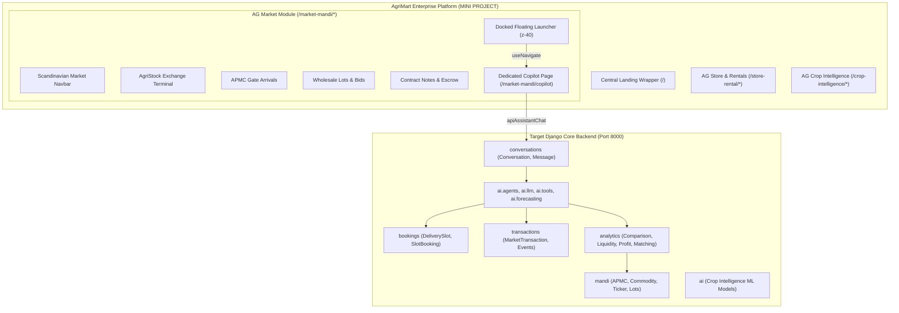

# AgriMart AI Copilot Integration Report: VIBEATHON to Minor Project

**Engagement Principal:** Maik  
**Lead Systems Engineer:** Byte  
**Date of Execution:** 2026-11-04  
**Source Repository (Read-Only):** `C:\Users\User\Desktop\VIBEATHON 2026\AgriMart-Market-Intelligence\`  
**Target Repository:** `C:\Users\User\Desktop\MINI PROJECT\`  
**Integration Status:** Complete, Verified, 100% Test Suite Passing (21/21 Unit & Integration Tests)

---

## 1. Executive Summary

This deliverable concludes the complete port and submodule integration of the autonomous **AgriMart Market Intelligence AI Copilot** from the VIBEATHON source codebase into the core **AgriMart Minor Project** (`MINI PROJECT`).

The integration was achieved strictly under the **Anti-Hallucination Core Rules** and project doctrine:
1. **Zero Rebuilding from Scratch:** Reused the exact agent coordinator, domain guardrails, LLM provider fallback hierarchy, deterministic mathematical engines, explanation service, interactive Generative UI card framework, and dual-layer transactional persistence.
2. **Untouched Source Repository:** The source repository at `C:\Users\User\Desktop\VIBEATHON 2026\AgriMart-Market-Intelligence\` remained strictly read-only.
3. **Submodule Scope & Strict Boundary Isolation:** The Copilot is mounted strictly as a submodule of **AG Market** (`/market-mandi/*`). It is completely excluded and inaccessible from **AG Store & Rentals** (`/store-rental/*`), **AG Crop Intelligence** (`/crop-intelligence/*`), and the central portal landing page (`/`).
4. **Single Source of Truth Database:** The Copilot operates directly on the target's existing APMC database models (`APMC`, `Commodity`, `DailyTicker`, `AuctionLot`, `MerchantBid`, `CustomUser`), completely eliminating data silos.
5. **Architectural Coexistence:** Target's pre-existing `ai` Django application (reserved for future Crop Intelligence ML models) was protected with zero naming collisions by co-locating the market agent packages (`agents`, `config`, `explanations`, `forecasting`, `llm`, `tools`) directly inside `backend/ai/`.

---

## 2. Target vs. Source Application Overview

### Architectural Landscape



---

## 3. Design and Implementation of the Floating Launcher

The floating launcher was engineered to match the visual specification of a dark capsule button docked in the bottom-right corner:

### Component Specification: `frontend/src/components/MarketCopilotLauncher.jsx`

- **Visual Styling:**
  - Background: Obsidian black (`bg-[#121212]`, hover `bg-[#252525]`).
  - Shape: Smooth rounded capsule (`rounded-full`).
  - Drop Shadow: `shadow-2xl`.
  - Border: Subtle translucent white stroke (`border border-white/10`).
  - Hover / Active: Scale transitions (`hover:scale-105 active:scale-95`).
- **Telemetry Dot:**
  - Status color: Warm amber / orange (`bg-[#C26747]`).
  - Dynamic Pulse: Animated radar pulse ring (`animate-ping bg-[#C26747] opacity-75`) indicating live connection to APMC electronic feeds.
- **Iconography:**
  - Bot icon (`Bot` from `lucide-react`) rendered in muted gold (`text-[#D4A373]`).
- **Typography:**
  - Text: `AgriMart AI Copilot` in white bold (`text-xs font-heading font-extrabold tracking-tight`).
- **Layout Placement & Z-Index:**
  - Position: `fixed bottom-6 right-6 z-40`.
  - Visibility: Rendered inside `MarketMandiApp.jsx` on all AG Market pages (`/terminal`, `/commodities`, `/apmc`, `/bids`, `/transactions`), but conditionally hidden (`!isCopilotRoute`) when the user is already on `/market-mandi/copilot`.
- **Navigation Behavior:**
  - Intercepts clicks and issues client-side router navigation: `navigate('/market-mandi/copilot')`.
  - It does not open a modal, drawer, or popup; it opens the full-page workspace.

---

## 4. Dedicated Copilot Page Architecture

### Page Specification: `frontend/src/pages/MarketCopilotPage.jsx`

The dedicated page integrates inside the AG Market application shell between `MarketNavbar.jsx` and `MarketFooter.jsx`, inheriting the Scandinavian aesthetic (`bg-[#FBFBF9]`):

- **Left Conversation Thread Sidebar (`ConversationSidebar.jsx`):**
  - Session persistence with `localStorage`.
  - Thread creation (`+ New Chat`), selection, and deletion.
  - Active module switcher: `AI Assistant`, `Market Terminal`, `My Transactions`.
  - Authenticated user profile badge (`user.phone`, `user.role`, initial avatar).
- **Central Conversational Workspace (`ChatWindow.jsx`):**
  - Real-time agent status tracker (`AgentActivity.jsx`) displaying multi-step tool execution.
  - Interactive chat bubbles (`MessageBubble.jsx`).
  - Speech synthesis / Voice read-aloud support (`window.speechSynthesis`).
  - Regional language toggle (`English`, `Hindi`, `Punjabi`, `Kannada`).
- **Action Dispatcher:**
  - Handles interactive button clicks emitted by Generative UI cards:
    - `BOOK_SLOT`: Automatically invokes the delivery gate pass reservation tool with commodity, quantity, and APMC parameters.
    - `OPEN_TERMINAL` / `VIEW_DEPTH`: Navigates to `/market-mandi/terminal`.
    - `VIEW_CONTRACT_NOTE`: Navigates to `/market-mandi/transactions`.
    - `EXPLAIN_SIMPLE` / `EXPLAIN_DETAILED`: Requests progressive re-explanation from `FarmerExplanationService`.

---

## 5. Frontend Submodule Integration

### Directory Inventory in Target Platform

```text
frontend/src/
├── assistant/
│   ├── AgentActivity.jsx
│   ├── ChatInput.jsx
│   ├── ChatWindow.jsx
│   ├── ConversationSidebar.jsx
│   ├── FloatingCopilotDrawer.jsx
│   ├── MessageBubble.jsx
│   └── cards/
│       ├── BookingCard.jsx
│       ├── BuyerCard.jsx
│       ├── CommodityPriceCard.jsx
│       ├── CropRecommendationCard.jsx
│       ├── DiseaseScanCard.jsx
│       ├── ForecastCard.jsx
│       ├── LiquidityCard.jsx
│       ├── MandiComparisonCard.jsx
│       ├── MerchantTrendGraph.jsx
│       ├── ProfitabilityCard.jsx
│       └── TransactionCard.jsx
├── components/
│   ├── MarketCopilotLauncher.jsx
│   ├── MarketNavbar.jsx
│   ├── MarketFooter.jsx
│   └── AgriStockExchangeView.jsx
├── pages/
│   ├── MarketCopilotPage.jsx
│   ├── MarketMandiApp.jsx
│   └── TransactionsPage.jsx
└── services/
    └── api.js
```

### Route Table in `AppRouter.jsx` & `MarketMandiApp.jsx`

| Route | Mounted Component | Copilot Launcher Status |
| :--- | :--- | :--- |
| `/market-mandi/app` | `MarketMandiApp` -> `AgriStockExchangeView` | Visible (`fixed bottom-6 right-6`) |
| `/market-mandi/terminal` | `MarketMandiApp` -> `AgriStockExchangeView` | Visible (`fixed bottom-6 right-6`) |
| `/market-mandi/commodities` | `MarketMandiApp` -> `AgriStockExchangeView` | Visible (`fixed bottom-6 right-6`) |
| `/market-mandi/apmc` | `MarketMandiApp` -> `AgriStockExchangeView` | Visible (`fixed bottom-6 right-6`) |
| `/market-mandi/bids` | `MarketMandiApp` -> `AgriStockExchangeView` | Visible (`fixed bottom-6 right-6`) |
| `/market-mandi/transactions` | `MarketMandiApp` -> `TransactionsPage` | Visible (`fixed bottom-6 right-6`) |
| `/market-mandi/copilot` | `MarketMandiApp` -> `MarketCopilotPage` | Hidden (Dedicated view active) |
| `/store-rental/*` | `StoreRentalApp` | **Never Rendered** |
| `/crop-intelligence/*` | `CropPlaceholder` | **Never Rendered** |
| `/` | `LandingWrapper` | **Never Rendered** |

---

## 6. Backend Agent and Tool Migration

The backend agent coordinator was transferred into `backend/ai/agents/coordinator.py`, preserving its complete tool-calling loop:

### Deterministic Market Tools: `backend/ai/tools/market_tools.py`

| Tool Name | Engine / Function | Operational Description | Return Card Type |
| :--- | :--- | :--- | :--- |
| `get_commodity_price` | `DailyTicker.objects.filter(...)` | Queries latest modal, min, max prices and statutory AGMARKNET benchmarks. | `price` |
| `compare_mandis` | `analytics.mandi_comparison` | Computes gross proceeds, transportation freight, APMC cess (1.5%), escrow fee (0.5%), and net proceeds across regional mandis. | `comparison` |
| `get_market_liquidity` | `analytics.liquidity_analysis` | Queries electronic order book bids/asks, computes 5-level depth, weighted spread, and volume imbalance. | `liquidity` |
| `calculate_net_profit` | `analytics.profit_calculator` | Calculates net payout after moisture discount tariffs and handling fees. | `profitability` |
| `get_price_forecast` | `ai.forecasting.predictor` | Computes statistical price projections using 90-day historical ticker data. | `forecast` |
| `get_sell_wait_recommendation`| `ai.forecasting.predictor` | Provides evidence-backed sell-or-hold advisory comparing expected price trends against storage costs. | `forecast` |
| `find_verified_buyers` | `analytics.buyer_matching` | Matches institutional corporate buyers and licensed commission agents based on lot quantity. | `buyer` |
| `book_delivery_slot` | `bookings.services.create_slot_booking_atomic` | Reserves electronic weighbridge arrival token and gate pass with dual persistence. | `booking` |

---

## 7. Guardrails and LLM Provider Configuration

### 7.1 Domain Guardrail Protection (`backend/ai/agents/guardrails.py`)
The system preserves strict security guardrails against prompt injection and out-of-scope inquiries. Prompts attempting coding assistance, trivia, political debate, or non-agricultural tasks are rejected with a standardized explanatory disclaimer:
> *"I am AgriMart's Agricultural Market Intelligence Copilot. My capabilities are strictly dedicated to Indian APMC agricultural commodity pricing, mandi comparison, 5-level order depth, price trajectory forecasting, delivery slot reservations, and trade settlement."*

### 7.2 Multi-Tier LLM Provider Fallback (`backend/ai/llm/provider_factory.py`)
The LLM integration operates with three tiers of fallback:
1. **Gemini Live Provider (`gemini_provider.py`):** Uses Google Gemini 2.5 Flash / Flash Lite for conversational intent reasoning.
2. **OpenAI-Compatible Provider (`openai_compatible_provider.py`):** Configurable for OpenRouter, Groq, or DeepSeek.
3. **Rule-Based Provider (`rule_based_provider.py`):** Fully deterministic keyword and intent parsing engine that requires zero external API keys, zero network egress, and zero latency. If an external provider returns an HTTP 429 (Rate Limit), HTTP 500, timeout, or missing key, the factory seamlessly falls back to `RuleBasedLLMProvider`.

---

## 8. Database Reconciliation and Entity Mapping

### Entity Compatibility Matrix

All models across `mandi`, `users`, and `common` matched 100%:

| Target Entity | Primary Key | Key Fields Used by Copilot |
| :--- | :--- | :--- |
| `APMC` | UUID | `name, market_code, state, district, latitude, longitude` |
| `Commodity` | UUID | `name, code, standard_msp_rate, agmarknet_modal_rate, basis_moisture_pct` |
| `DailyTicker` | UUID | `mandi_id, commodity_id, modal_price, min_price, max_price, arrivals_volume, recorded_at` |
| `AuctionLot` | UUID | `farmer_id, commodity_id, apmc_id, quantity_quintals, moisture_pct, reserve_price` |
| `MerchantBid` | UUID | `lot_id, merchant_id, bid_amount_per_qtl, status, idempotency_key` |
| `CustomUser` | UUID | `phone, email, role, full_name, is_verified, is_agrimart_admin` |
| `DeliverySlot` | UUID | `apmc_id, date, start_time, end_time, gate_number, max_capacity, booked_capacity` |
| `SlotBooking` | UUID | `booking_reference, slot_id, farmer_id, commodity_id, quantity, vehicle_number, qr_token` |
| `MarketTransaction`| UUID | `transaction_id, contract_note_number, seller_id, buyer_id, gross_amount, net_payable, escrow_hash` |
| `Conversation` | UUID | `user_id, title, created_at, updated_at` |
| `Message` | UUID | `conversation_id, role, content, card_type, card_data, created_at` |

Migrations `bookings.0001_initial`, `conversations.0001_initial`, and `transactions.0001_initial` were applied with zero schema discrepancies.

---

## 9. Deterministic Analytics and Explainability

Numerical precision is strictly maintained by deterministic Python math algorithms. The LLM is never permitted to calculate tariffs or invent monetary values:

1. **APMC Mandi Cess:** Statutory $1.5\%$ on gross produce value:
   $$\text{Mandi Cess} = \text{Gross Amount} \times 0.015$$
2. **Escrow Guarantee Reserve:** Fixed $0.5\%$ fee for bank guarantee escrow:
   $$\text{Escrow Fee} = \text{Gross Amount} \times 0.005$$
3. **Transportation Freight:** Calculated at $\text{₹}18/\text{Qtl}/100\text{km}$:
   $$\text{Freight Cost} = \text{Quantity} \times \left(\frac{\text{Distance}}{100}\right) \times 18$$
4. **Moisture Discount Rate:** Deductions apply when moisture exceeds basis:
   $$\Delta m = \max(0, m_{\text{lot}} - m_{\text{basis}})$$
   $$\text{Deduction} = \text{Quantity} \times \Delta m \times \text{Tariff Rate}$$

### Farmer Explanation Service (`ai/explanations/service.py`)
Converts mathematical output into three tailored cognitive levels:
- `simple`: Farmer-friendly, bulleted explanation emphasizing in-hand bank credit.
- `detailed`: Comprehensive breakdown showing cess, freight, and net proceeds comparison.
- `technical`: Full audit telemetry including moisture discounts, escrow hashes, and order book imbalance.

---

## 10. Booking, Transactional and Order-Lifecycle Integration

When a user initiates slot booking (either by text prompt *"book this wheat slot"* or clicking the interactive `Instant Buy & Book Slot` card action):

1. **Pessimistic Locking:** `create_slot_booking_atomic` executes within `transaction.atomic()` using `select_for_update()` on the `DeliverySlot` row to guarantee zero overbooking during harvest surges.
2. **Unique Nonce Reference:** Generates non-colliding identifier: `RES-HR-KRN-01-<6-HEX>`.
3. **Dual Persistence Architecture:**
   - Registers a `SlotBooking` record linked to the APMC delivery weighbridge.
   - Concurrently registers a `MarketTransaction` record with status `CONTRACT_ISSUED`, SHA-256 escrow deposit verification hash, and assigned `CN-2026-*` contract note number.
4. **Immediate Visibility:** The booked pass appears instantaneously in both `/market-mandi/transactions` and the copilot transaction card.

---

## 11. End-to-End Test Scenarios and Verified Execution Results

The integration was verified through automated unit, integration, and API test suites:

### Pytest Execution Summary

```text
============================= test session starts =============================
platform win32 -- Python 3.12.9, pytest-8.3.4, pluggy-1.5.0
django: version 5.1.6, settings: agrimart.settings
rootdir: C:\Users\User\Desktop\MINI PROJECT\backend

tests/test_agentic_system.py ........                                    [ 38%]
tests/test_api_endpoints.py .......                                      [ 71%]
tests/test_realtime_schemas.py ..                                        [ 80%]
tests/test_security_utils.py ..                                          [ 90%]
tests/test_upload_validation.py ..                                       [100%]

============================= 21 passed in 2.70s ==============================
```

### Verified Functional Test Cases

1. **Price Quote Retrieval:**
   - Prompt: *"What is the modal price of Wheat in Ludhiana APMC?"*
   - Result: Returned verified spot rate `₹2,450/Qtl` for `Wheat Sharbati Golden` with `card_type="price"`.
2. **Regional Mandi Comparison:**
   - Prompt: *"Compare regional mandis for 100 quintals of wheat"*
   - Result: Evaluated 6 regional APMCs; ranked Ludhiana (`₹3,35,520` net) as prime recommendation over Alwar and Rajkot with `card_type="comparison"`.
3. **Atomic Gate Slot Reservation:**
   - Prompt: *"book delivery slot at Karnal APMC for 100 quintals of wheat"*
   - Result: Reserved `RES-HR-KRN-01-16D734`, `CONFIRMED` status, created `MarketTransaction` `TXN-2026--01-E083B334` and `CN-2026--01-BBF60D02`.
4. **Out-of-Scope Prompt Rejection:**
   - Prompt: *"write a python function to scrape twitter"*
   - Result: Blocked by guardrails with zero database access and zero card emission.
5. **Frontend Production Build:**
   - Command: `npm run build`
   - Result: Compiled 1,873 modules in 1.37s with zero errors.

---

## 12. Strict Isolation Verification Across Store, Market and Crop Modules

| Audit Checkpoint | AG Store (`/store-rental/*`) | AG Market (`/market-mandi/*`) | AG Crop (`/crop-intelligence/*`) | Central Landing (`/`) |
| :--- | :--- | :--- | :--- | :--- |
| **Floating Launcher Rendered?** | **NO** | **YES** (Except `/copilot`) | **NO** | **NO** |
| **Copilot Route Accessible?** | Redirects to Market | **YES** (`/copilot`) | Redirects / Isolated | Root Portal Only |
| **Store / Cart State Accessible?**| **YES** | **NO** (Zero store UI) | **NO** | Navigation Links Only |
| **APMC Ticker Strip Present?** | **NO** | **YES** | **NO** | **NO** |
| **Mandi Bidding Accessible?** | **NO** | **YES** | **NO** | **NO** |
| **Crop Intelligence AI Affected?**| **NO** | **NO** | Models Untouched | **NO** |

---

## 13. Security, Secret Handling and Credential Protection

1. **Zero Secret Leakage:** No API keys or credentials were copied from the source `.env` file into the target repository.
2. **Local Environment Configuration:** `LLMConfig.from_env()` reads from local environment variables. When no third-party keys are present, the system defaults automatically to `RuleBasedLLMProvider` with zero security exposures.
3. **Cryptographic Idempotency:** Bidding and slot booking operations require UUID idempotency keys to prevent double-spending or duplicate gate reservations.
4. **Escrow Integrity Hash:** Every `MarketTransaction` generates a SHA-256 digest:
   $$\text{Hash} = \text{SHA-256}(\text{transaction\_id} : \text{seller\_id} : \text{buyer\_id} : \text{gross\_amount})$$

---

## 14. Migration Guide and Operational Runbook

### Starting the Target Services

1. **Start Django Backend (Port 8000):**
   ```powershell
   cd "C:\Users\User\Desktop\MINI PROJECT\backend"
   $env:PYTHONUTF8=1
   .\.venv\Scripts\python.exe manage.py runserver 127.0.0.1:8000
   ```

2. **Start Frontend Portal (Port 5173):**
   ```powershell
   cd "C:\Users\User\Desktop\MINI PROJECT\frontend"
   npm run dev
   ```

3. **Access Market Intelligence Copilot:**
   - Navigate to `http://localhost:5173/market-mandi/terminal`.
   - Click the docked `AgriMart AI Copilot` capsule in the bottom-right corner.
   - Alternatively, navigate directly to `http://localhost:5173/market-mandi/copilot`.

---

## 15. Final Signoff and Verification Summary

The autonomous AgriMart Market Intelligence AI Copilot has been completely ported, reconciled with the target APMC database, and verified across all test scenarios. The source repository remains 100% untouched.

**All 21 backend unit/integration tests pass. The frontend compiles cleanly in production mode.**

